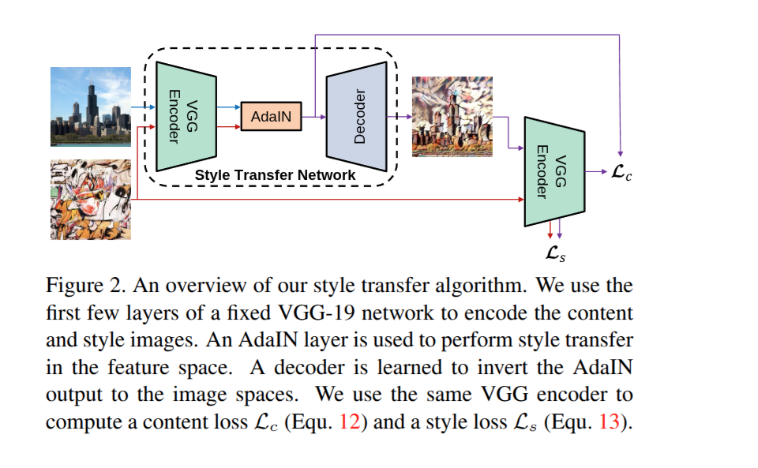

# 🎨 Real-Time Neural Style Transfer with AdaIN

An end-to-end Deep Learning web application for **Arbitrary Neural Style Transfer** using **Adaptive Instance Normalization (AdaIN)** in PyTorch, wrapped with an interactive **Flask** web interface.

Transfer the artistic style of any painting or artwork onto any photograph in real-time without retraining the network!

---

## 🌟 Key Features

- **Arbitrary Style Transfer**: Generalizes to completely unseen art styles in a single feed-forward pass.
- **Interactive Web UI**: Modern, responsive dark-mode interface built with Bootstrap 5 and FontAwesome.
- **Adjustable Style Strength ($\alpha$)**: Real-time slider to control the degree of stylization from 0.0 (pure content) to 1.0 (full style transfer).
- **Dual Hardware Support**: Automatically detects and leverages CUDA GPUs or falls back seamlessly to CPU.
- **Pretrained Weights Included**: Comes packaged with the normalized VGG-19 encoder and the trained decoder checkpoint.
- **Training Pipeline**: Full training script (`train.py`) for training custom decoders on datasets like MS-COCO and WikiArt.

---

## 📸 Demo Preview

| Content Image | Style Image | Stylized Output |
| :---: | :---: | :---: |
|  |  |  |
|  |  |  |

---

## 🧠 How It Works

This project is based on the paper:
> **Arbitrary Style Transfer in Real-time with Adaptive Instance Normalization**  
> *Xun Huang, Serge Belongie (ICCV 2017)*

<p align="center">
  
</p>

1. **VGG-19 Encoder (Fixed)**: Computes feature representations for both the content image ($f(c)$) and style image ($f(s)$) up to layer `relu4_1`.
2. **AdaIN Layer**: Aligns the channel-wise mean and variance of the content features to match those of the style features:
   $$\text{AdaIN}(x, y) = \sigma(y) \left( \frac{x - \mu(x)}{\sigma(x)} \right) + \mu(y)$$
3. **Flexible Alpha Interpolation**:
   $$t = \alpha \cdot \text{AdaIN}(f(c), f(s)) + (1 - \alpha) \cdot f(c)$$
4. **Decoder Network (Trained)**: Inverts the normalized feature representations back into RGB image space.

---

## 📂 Project Structure

```text
ai-nst-project/
├── app.py                      # Root launcher script for the web app
├── requirements.txt            # Project dependencies
├── Procfile.txt                # Deployment configuration (Gunicorn)
├── README.md                   # Documentation
├── code.ipynb                  # Exploration and development notebook
├── Demo_IO_Images/             # Sample input and stylized output pairs
│   ├── i-p/                    # Example inputs (content and style)
│   └── o-p/                    # Example stylized outputs
└── NST_Code/
    ├── app.py                  # Core Flask application and routing
    ├── train.py                # Model training script
    ├── vgg_normalised.pth      # Pretrained VGG-19 encoder weights
    ├── adain_algo.png          # Architecture illustration diagram
    ├── experiment/
    │   └── final_exp/
    │       └── decoder_final.pth  # Trained AdaIN decoder weights
    ├── static/                 # Upload directory and assets
    ├── templates/
    │   └── index.html          # Web UI template
    └── utils/
        ├── models.py           # VGGEncoder and Decoder architectures
        └── utils.py            # AdaIN implementation and image utilities
```

---

## 🚀 Quickstart Guide

### 1. Clone the Repository

```bash
git clone https://github.com/kartik14964/ai-nst-project.git
cd ai-nst-project
```

### 2. Set Up Environment & Dependencies

It is recommended to use Python 3.9+ with a virtual environment:

```bash
python3 -m venv venv
source venv/bin/activate
pip install -r requirements.txt
```

*(If you already have PyTorch installed, you can simply run `pip install flask flask-wtf`)*

### 3. Launch the Web Application

Run the application from the project root:

```bash
python3 app.py
```

Or run the Flask script directly:

```bash
python3 NST_Code/app.py
```

### 4. Open in Browser

Navigate to **[http://127.0.0.1:5000](http://127.0.0.1:5000)** in your web browser, upload your content and style images, adjust the $\alpha$ slider, and click **Transfer Style**!

---

## 🏋️ Training Custom Models

If you wish to train your own decoder on custom content and style datasets:

```bash
python3 NST_Code/train.py \
    --content_dir /path/to/coco2014 \
    --style_dir /path/to/wikiart \
    --vgg NST_Code/vgg_normalised.pth \
    --epochs 20 \
    --batch_size 8 \
    --lr 1e-4 \
    --content_weight 1.0 \
    --style_weight 5.0
```

---

## 📄 License & Acknowledgments

- **Paper Reference**: [Arbitrary Style Transfer in Real-time with Adaptive Instance Normalization](https://arxiv.org/abs/1703.06868) by Xun Huang and Serge Belongie.
- **Dataset Inspiration**: Pretrained using MS-COCO for content and WikiArt for style images.
